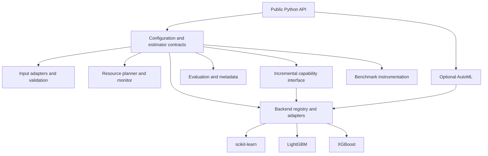
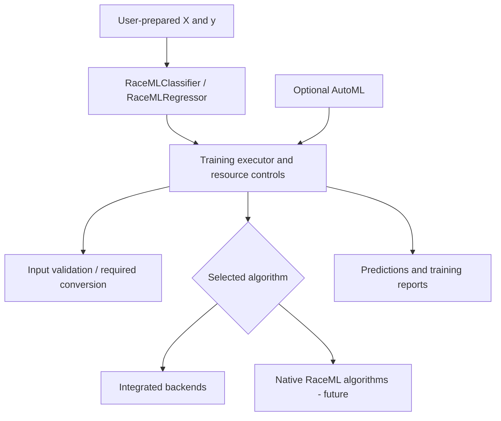

# RaceML Architecture

**Status:** Proposed, not implemented.

## 1. Architectural principles

Python-first; modular; backend adapters; explicit capabilities; minimal core dependencies; opt-in AutoML; benchmark before native optimization.

## 2. Component diagram

## 3. Dependency direction

- Public API calls core contracts, never a concrete backend directly.
- Backend adapters implement a common protocol; backend-specific features remain explicitly named.
- Input layer validates prepared inputs and selects conversions according to backend needs.
- Resource layer plans threads and records observations; it does not claim OS-enforced limits.
- AutoML depends on the core and registry, but the core never depends on AutoML.
- Incremental operations are exposed only if the adapter declares support.
- Benchmark harness can instrument the library or direct-backend baseline.

## 4. Execution lifecycle

1. Validate user configuration and dataset schema.
2. Resolve backend and declared capabilities.
3. Plan CPU threads and optional memory budget.
4. Convert inputs, measuring copies and conversion time when possible.
5. Fit with controlled seeds and backend parameters.
6. Record elapsed time, peak RSS and model metadata.
7. Evaluate on explicit validation data, without leaking test labels.
8. Return model and report; persist only on user request.

## 5. Model backend contract

Adapters must implement fit, predict, get_params, metadata, capability discovery and, where supported, predict_proba, update, save/load. Unsupported operations raise typed errors. No silent model substitution.

## 6. Resource boundaries

- `cpu_cores` is mapped to backend-specific thread settings and recorded; external BLAS/OpenMP pools may require additional control.
- `memory_limit` initially represents a monitored budget. A strict cap needs a subprocess supervisor and platform-specific enforcement.
- Benchmarks measure the entire process tree where possible, not only Python allocations.
- For out-of-core workflows, support is declared per backend and algorithm, not assumed universally.

## 7. Data representation

NumPy/pandas first; Polars and Arrow supported through explicit adapter paths. Zero-copy is an optimization to verify per backend, dtype and layout; it is not a blanket promise.

## 8. Extension model

Registry entries include backend name, version, supported tasks, probability support, incremental capability, data format constraints and serialization methods. Optional packages must fail with installation guidance rather than import-time failure of the entire library.

## 9. Native code policy

No Rust dependency in the first vertical slice. Introduce Rust/PyO3/maturin only after a benchmark isolates a bottleneck and an experimental implementation demonstrates a repeatable gain net of FFI overhead.

## 10. Observability and reproducibility

Record wall-clock times, phase timings, peak RSS, CPU limits, algorithm configuration, package versions, OS, CPU description, data fingerprint, split seed and metric. Exclude secrets and private dataset rows from logs by default.

## 11. Security

Treat model files and plugins as untrusted. Do not deserialize arbitrary Python objects from unknown sources. Prefer explicit format restrictions, provenance metadata and warnings.

## 12. Architecture decision records

Use `docs/decisions/NNNN-title.md` for irreversible or high-cost decisions. First ADR: Python-first execution and optional native kernels.

## Approved boundary revision

The former data subsystem is limited to **input validation and backend-required conversion**; it is not a loader, cleaner, feature-engineering system, or preprocessing pipeline. Training has two interchangeable backend families: integrated adapters (initial delivery) and independent native RaceML algorithms (later milestone). The public API uses `RaceMLClassifier` and `RaceMLRegressor`. See `SCOPE.md` and `NATIVE_ENGINE.md`.

