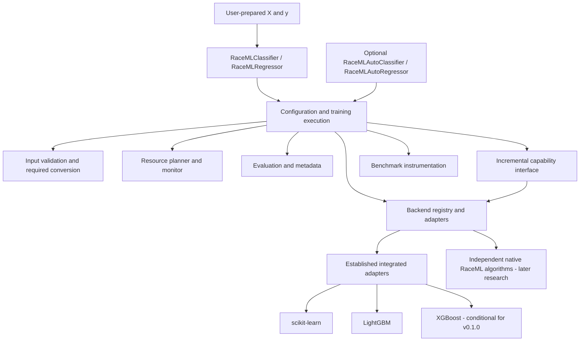

# RaceML Architecture

**Status:** Established boundaries preserved; reconciled specification for Phase 0A review. Not implemented.

## 1. Architectural principles

Python-first; modular; backend adapters; explicit capabilities; minimal core dependencies; opt-in AutoML; benchmark before native optimization. Users supply prepared features, targets and validation splits. RaceML performs input validation and backend-required conversion only; it has no data-loading, cleaning, imputation, feature-engineering or splitting subsystem. See [SCOPE.md](SCOPE.md).

## 2. Component diagram

## 3. Dependency direction

- Public API calls core contracts, never a concrete backend directly.
- Backend adapters implement a common protocol; backend-specific features remain explicitly named.
- Input layer validates prepared inputs and selects conversions according to backend needs.
- Resource layer plans threads and records observations; it does not claim OS-enforced limits.
- AutoML depends on the core and registry, but the core never depends on AutoML.
- Manual estimator imports and execution must not import or invoke the optional tuner.
- Incremental operations are exposed only if the adapter declares support.
- Benchmark harness can instrument the library or direct-backend baseline.
- Integrated and future independent native adapters use the same estimator contracts; an integrated wrapper is not a native RaceML algorithm.

## 4. Execution lifecycle

1. Validate user configuration and dataset schema.
2. Resolve backend and declared capabilities.
3. Plan CPU threads and optional memory budget.
4. Convert inputs, measuring copies and conversion time when possible.
5. Fit with controlled seeds and backend parameters.
6. Record elapsed time, peak RSS and model metadata.
7. Evaluate when explicit user-prepared validation data is supplied, without using held-out test labels for selection. Never create a split inside RaceML.
8. Expose the fitted estimator and resource report; persist only on user request. Public return signatures are specified in [DESIGN.md](DESIGN.md) and remain subject to Phase 0A review.

## 5. Model backend contract

Adapters must implement fit, predict, get_params, metadata, capability discovery and, where supported, predict_proba, update, save/load. Unsupported operations raise typed errors. No silent model substitution.

The minimal registry, capability declarations and errors must precede the first LightGBM adapter in Phase 1. Capability-dependent operations are not universally required methods on the base protocol. Exact capability types and fitted-state behavior must be finalized before implementation; see [ADR 0002](docs/decisions/0002-training-contracts.md).

## 6. Resource boundaries

- `cpu_cores` is mapped to backend-specific thread settings and recorded; external BLAS/OpenMP pools may require additional control.
- `memory_limit` initially represents a monitored budget. A strict cap needs a subprocess supervisor and platform-specific enforcement.
- Benchmarks measure the entire process tree where possible, not only Python allocations.
- For out-of-core workflows, support is declared per backend and algorithm, not assumed universally.
- Thread-setting conflicts, memory-budget units and overrun behavior remain technical decisions; no silent precedence or hard-enforcement guarantee is implied.

## 7. Data representation

NumPy/pandas are planned for Phase 1; measured Polars and Arrow conversion paths remain v0.1.0 requirements and are assigned to Phase 2. Zero-copy is an optimization to verify per backend, dtype and layout; it is not a blanket promise. Algorithm-native missing-value, binning and categorical handling may be supported explicitly without introducing a general preparation API.

## 8. Extension model

Registry entries include backend name, version, supported tasks, probability support, incremental capability, data format constraints and serialization methods. Optional packages must fail with installation guidance rather than import-time failure of the entire library.

## 9. Native code policy

No Rust dependency in the first vertical slice. Independently developed native algorithms require an approved design and benchmark plan, then a correct single-threaded reference before optimization. Introduce Rust/PyO3/maturin only after profiling and experiments demonstrate a repeatable benefit net of FFI overhead and explicit approval is obtained. See [NATIVE_ENGINE.md](NATIVE_ENGINE.md) and [ADR 0001](docs/decisions/0001-python-first.md).

## 10. Observability and reproducibility

Record wall-clock times, phase timings, peak RSS and its measurement scope, CPU limits, algorithm configuration, package versions, OS, CPU description, data fingerprint and metric. Record split identifiers or seeds when supplied by the user; RaceML does not generate dataset splits. Fingerprint policy and cost remain to be defined. Exclude secrets and private dataset rows from logs by default.

## 11. Security

Treat model files and plugins as untrusted. Do not deserialize arbitrary Python objects from unknown sources. Prefer explicit format restrictions, provenance metadata and warnings.

## 12. Architecture decision records

Use `docs/decisions/NNNN-title.md` for irreversible or high-cost decisions. [ADR 0001](docs/decisions/0001-python-first.md) records the established Python-first boundary; [ADR 0002](docs/decisions/0002-training-contracts.md) proposes the reconciled training contracts and module map for review. The [Phase 0 report](docs/PHASE_0_REPORT.md) separates established decisions, review proposals and unresolved details. No component is implemented by this documentation change.
