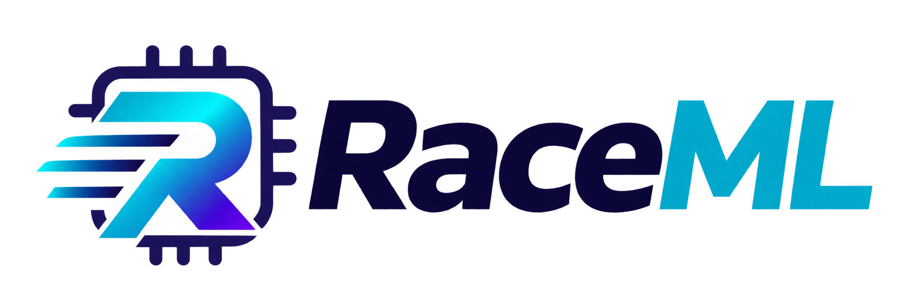

<div align="center">
  

  **Resource-Aware Compute Engine for Machine Learning**

  **Faster training. Less memory. One interface.**

  [](LICENSE)
  
</div>

RaceML is an open-source, CPU-first machine learning project aiming to provide a common Python interface for model training, evaluation, resource-aware execution, optional automated model selection, and incremental updates for supported estimators.

> **Status:** Pre-development. There is no released implementation or validated performance result. Targets of 20% less end-to-end training time and 30% less peak memory on selected workloads are research targets, not measured results.

## Principles

- Initially focus on tabular classification and regression.
- Accept user-prepared data; loading, cleaning, feature engineering, and splitting remain the user's responsibility.
- Use a Python-first approach. Introduce Rust when profiling demonstrates a benefit.
- Support established model backends and, later, independently developed native RaceML algorithms.
- Keep manual configuration the default; AutoML is optional.
- Report performance through fair, reproducible benchmarks. A wrapper alone does not make an underlying algorithm faster.

## Planned API

The following example is **proposed** and is not yet executable:

```python
from raceml import RaceMLClassifier, RaceMLRegressor

model = RaceMLClassifier(algorithm="lightgbm", cpu_cores=4)
model.fit(X_train, y_train)
predictions = model.predict(X_test)
```

## Planned integrations

Initial integrations: scikit-learn, LightGBM, and XGBoost. Later work may include CatBoost, incremental estimators, native algorithms, and GPU support.

## Documentation

- [Product requirements](PRD.md)
- [Architecture](ARCHITECTURE.md)
- [Design](DESIGN.md)
- [Scope](SCOPE.md)
- [Native engine](NATIVE_ENGINE.md)
- [Benchmarks](BENCHMARKS.md)
- [Roadmap](ROADMAP.md)
- [Agent instructions](AGENTS.md)
- [Testing](TESTING.md)
- [Contributing](CONTRIBUTING.md)
- [Governance](GOVERNANCE.md)
- [Code of conduct](CODE_OF_CONDUCT.md)
- [Security](SECURITY.md)
- [Licence](LICENSE)

## Contributing

RaceML is open source under the [Apache License 2.0](LICENSE). Read [CONTRIBUTING.md](CONTRIBUTING.md) before opening a pull request.
